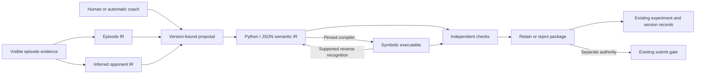

# Semantic IR ↔ symbolic policies as an optimizer-seed extension

> **Status:** In Review · **Created:** 2026-09-20 · **Scope:** proposed extension, with checked representation examples

## Summary

Add an optional semantic-policy binding to optimizer-seed. A policy becomes an immutable package containing a seven-layer semantic IR, its executable, versioned implementation bindings and separate evidence for representation consistency, behavioral fidelity and competitive performance. Humans and an autoresearcher can edit either representation, reconcile the change, test it, and retain or reject the whole pair. The same semantic vocabulary describes observed opponents, while distinct artifact types prevent an inferred model from silently becoming an executable opponent.

Python remains the readable authoring medium used in our GotA policies; JSON is the interchange and validation medium. Markdown and the coaching IDE are views and contribution surfaces. A game adapter owns compilation, supported reverse recognition, observation semantics and runtime checks. Core owns artifact identity, evidence links, workflow and explicit capability failures. We build on the seed's experiment/memory/submission process rather than introducing a second research database or a universal prose compiler.

**What this branch delivers:** this specification, contracts, an optional workflow/template, source-backed design rationale, positive/negative representation fixtures and a checker. It does not implement a generic game compiler, an unattended scheduler, a production IDE integration or new league policies. Commands marked *proposed* are interface requirements, not installed tools.

## Problem

Our iterations exposed several different failures that one “IR verified” flag hides:

- A JSON/Python/BASIC pair can round-trip exactly while its claimed meaning remains untested. The Pudge registered whole-program converter explicitly makes this distinction.
- A rule can pass an activation fixture and never affect a real match: both support restorations reproduced every baseline command in their six-case screen.
- Multiple rules act in one tick. Observation helpers may also choose defense; spells, purchases, target changes and movement coexist. A single “winning rule” or final target cannot explain the whole decision.
- Good matchup results can regress elsewhere. The Jordan counter's nearby recall preserved pressure against Jordan but removed useful remote defense against Alex. Later adaptive variants restored Alex/Jordan wins while still failing Richard red. Results belong to exact artifacts, opponents, colors and configurations.
- A motif model may predict visible categories without recovering a controller. Richard's later source audit exposed ordered overrides, a four-decision neural clock and one-decision recovery; its defining tower-retaliation branch never activated in the original twenty-game corpus.
- A recording can reference the wrong policy. Co-play now preserves corrected associations and superseded analyses, but a selected reference still does not prove which executable ran.
- Copying a few compiler modules missed transitive bindings or pinned engine data. Mac-only paths and snapshots whose dependencies live in a sibling checkout do not make a reproducible package.

These are measured engineering lessons, not proof that the proposed workflow improves policy quality. The [source review](semantic-ir/source-review.md) ties each design decision to inspected code and dated experiments.

## Goals

- [ ] Preserve our existing seven-layer Python/JSON representation and immutable historical artifacts through explicit adapter/import profiles.
- [ ] Define independently checkable forward conversion, bounded reverse recognition, behavioral meaning and performance claims.
- [ ] Represent ordered multi-rule decisions, observable information, persistent memory, action acceptance and side effects faithfully.
- [ ] Support source-derived and observation-derived opponent IR without claiming hidden intent, source recovery or rollout fidelity from prediction accuracy alone.
- [ ] Make coaching attributable: original contribution → interpretation → semantic/code patch → frozen checks → measured result, including declined and failed work.
- [ ] Make a package verifiable from a clean checkout on another host, with dependency closure and evidence scope visible.
- [ ] Reuse the seed's records, version log, refutations, autonomy preferences and submission gate.

## Non-goals

Arbitrary natural-language-to-code correctness, decompiling every program into authored intent, universal game mechanics, guaranteed league leadership, a replacement IDE, a mandatory hosted service, or changing the seed's default strategic autonomy. Opaque learned components are possible with declared boundaries; calling them semantic does not explain their internals.

## Decisions

| Decision | Reason |
|---|---|
| Keep seven semantic layers; use adapter-specific schema IDs | Preserves existing Python/JSON work without pretending GotA and Pudge already implement the same compiler |
| Freeze one authoritative package revision | Avoids independent IR, code, IDE and evaluator histories disagreeing about the incumbent |
| Use a checked compiler and a **partial** reverse recognizer | Unknown control flow must fail visibly; comments and claimed rule IDs do not prove program meaning |
| Track checks separately | Representation, trace fidelity, intent fidelity, runtime validity, gameplay outcomes and authority answer different questions |
| Model ordered effects, not one rule per tick | Host command order and cross-channel cancellation can change behavior |
| Treat opponent inference as scientific modeling | A useful forecast is not automatically a causal mechanism or responsive policy |
| Freeze the tests/verifier outside candidate writes | A coder must not be able to make a failing policy pass by rewriting its checker |
| Keep the IDE an evidence/patch client | Its selected reference, human interpretation and saved draft are inputs, not acceptance decisions |
| Make the binding optional | Games without IR support keep the existing seed workflow; unavailable claims are reported precisely |

## Architecture and integration



A game opts in through an additional `semantic-policy` entry in `MIXIN.md`, implemented under `games/<g>/skills/semantic-policy/`. The original five bindings stay required; the new one is optional. A proposed `semantic-capabilities.json` records operations, implementation/version hashes, native schema IDs and supported claim levels. Core never branches on game names or assumes Docker versus raw-source policy artifacts.

Suggested durable placement:

```text
games/<g>/
  skills/semantic-policy/          # declared adapter and capability contract
  instruments/semantic_ir/         # game compiler/extractor/probes/scenario checks
  players/<p>/revisions/<id>/      # immutable policy + IR + manifest + receipts
  players/<p>/incumbent.json       # small atomic pointer, not copied policy text
  players/<p>/VERSION_LOG.md       # existing mandatory upload record
  opponents/<version>/<study>/    # inferred models / source audits / proxy packages
  episodes/<episode>/<perspective>/ # semantic account and compact provenance
  experiments/<id>.md             # existing authoritative hypothesis/verdict record
  experiments/<id>/               # small plans, patches, checks and result manifests
.runtime/<game>/                  # replay/media/large traces and working runs
```

`META.md` remains the dated field picture; `WORKING_CONTEXT.md` points to active work; `closed_levers.md` preserves scoped failures. Evidence manifests reference these records rather than creating a competing hypothesis ledger. Large/private evidence stays out of Git with content hashes and retrieval identifiers. Paths are package-relative or explicit artifact-store references; `/Users/...` is historical provenance only.

## 1. Representation and authority

To bootstrap a lab reliably:

1. Run the checked-in examples (`python3 tools/check_semantic_ir_examples.py`), then declare the lab's optional `semantic-policy` binding. The fixture command does not install a native adapter.
2. Choose a frozen existing policy/version and preserve its Python, JSON, source and original hashes. Implement read-only native validation, manifest verification and capability discovery before authoring changes.
3. Reproduce its recognized pair and complete dependencies in a clean checkout. Advertise unsupported operations explicitly. Do not admit new source until the corresponding reverse recognizer and independent meaning tests exist.
4. Import one fully audited episode and one coaching contribution with verified references/clocks. Produce linked findings and a frozen hypothesis in the seed's existing experiment record.
5. Run one attributable semantic change through fidelity, runtime and hosted checks, retaining or rejecting the complete pair. Add scheduling only after recovery/budget tests and recorded authorization for that scope.

A native IR retains the established top-level form:

```python
POLICY = {
    "schema": "<adapter-owned-policy-schema>",
    "id": "<stable-policy-id>",
    "situation": {...}, "belief": {...}, "goal": {...},
    "skill": {...}, "strategy": [...],
    "execution": {...}, "update": {...},
}
```

Opponent models use `MODEL` and a distinct native schema. They retain `id / when / skill / for` preferences and evidence-backed claims where supported by that profile. A common envelope describes artifact kind and compatibility; it does not rewrite old native JSON or teach an old compiler to accept a new shape. The sample schemas validate the common structural minimum. Only the named adapter can validate native meaning or compile it.

| Layer | Contract |
|---|---|
| `situation` | Observable predicates, units, affordances, source fields, missingness and computation time; derived groundings distinguish facts from author notes |
| `belief` | Runtime estimates/memory **and separately** researcher claims; evidence, status, alternatives, scope, expiry and revision triggers |
| `goal` | Authored objective priorities or explicitly inferred/unknown purposes; descriptive goals do not silently affect compilation |
| `skill` | Operator/version, parameters, initiation, output/effect channels, memory dependencies, termination and interruption |
| `strategy` | Stable rules/preferences linking conditions, skills and goals; execution/priority semantics must be declared rather than inferred from presentation order |
| `execution` | Bound language/runtime, observation/action API, ordered effects, clocks, reset rules, limits and dependency identities |
| `update` | Parent revision, change origin, semantic diff, evidence additions and claims requiring review |

A frozen revision using the literal-data profile contains `policy.py`, `policy.ir.json`, generated executable, binding/compiler lock, semantic/source mapping, manifest and receipts. Here `policy.py` is a convenient authoring view, not privileged executable Python: import via an AST/literal reader, not `exec`, `runpy` or arbitrary module import. Permit one assignment plus comments/docstring; reject imports, calls, comprehensions, attributes, unpacking and duplicate keys. New core examples use JSON values only. A trusted legacy adapter may translate a richer trusted authoring module in an isolated build, then export literal data; the exception must never apply to observed opponent files.

Artifact **roles**, not filenames, determine dispatch. Pudge currently registers
native `ir.md` text against executable `policy.py`; GotA's primary `policy.py` is
literal IR data. Preserve Pudge's native text/source under their explicit roles
and original hashes. A shared JSON/Python view is a separately validated adapter
projection when supported, never an automatic prose-to-JSON migration. A legacy
package can be imported read-only with that projection unavailable.

On import, compare the two data values. On edits, the author explicitly selects Python, JSON, or a proposed symbolic patch as the input; there is no “newest mtime wins.” Generate other views into a new candidate directory. Concurrent edits carry an expected parent revision; mismatches become explicit three-way reconciliation. Markdown is a generated/annotated view with block IDs, not a second unchecked source of executable truth.

[Contracts](semantic-ir/contracts.md) specify value normalization, hashes, artifact kinds, manifests, receipts and example shapes. Old source and JSON hashes stay exactly as recorded. New serialization profiles have their own IDs and test vectors; migration is a new revision, never silent recanonicalization of historical evidence.

## 2. IR → symbolic → IR reliability

Let `C_B(I)` be deterministic compilation under pinned binding closure `B`; `E_B(S, P)` be partial reverse recognition of source `S` with optional parent semantic context `P`; `N_B(S)` be the adapter's conservative executable normalization; and `X_B(I)` be its declared behavior-affecting projection.

Required laws, scoped to the supported language:

1. **Determinism:** identical IR, binding closure and target yield identical generated source bytes. If the binary toolchain is not bit reproducible, record that separately and pin the actual tested binary.
2. **Forward/reverse consistency:** `X_B(E_B(C_B(I), I)) == X_B(I)` and `N_B(C_B(E_B(C_B(I), I))) == N_B(C_B(I))`.
3. **Supported symbolic edit:** when extraction succeeds, `N_B(C_B(E_B(S, P))) == N_B(S)` over the **whole** executable. Unknown, unconsumed or ambiguous statements are errors, with source spans and a suggested binding-extension path.
4. **Semantic honesty:** goals, rationale and belief claims carried from a parent remain attributed to it; reverse recognition does not recover intention from bytes. New rules may have unknown goals. Changed dependencies invalidate affected claims, conservatively all claims when dependency tracking is unavailable.
5. **No false identity from labels:** deleting/spoofing region comments, appending an executable statement, or adding an ambiguous registry entry must not make an unsupported program pass.

An AST round trip verifies a declared structural equivalence relation, not universal behavioral equivalence. Exact source bytes identify what was uploaded. Changing formatting may preserve normalized structure but still produces a new source artifact and requires a recorded equivalence result before reusing evidence. An IR-only evidence annotation may retain tested source bytes; its old performance receipt still references the old revision, with an explicit identity link to the new one.

The binding registry is immutable/versioned and contains all executable dependencies: generator, recognizer, parser/normalizer, templates, imported modules, constants/weights, engine data and target flags. Each operator declares observation/memory reads, writes, effect channels, parameter bounds, reset semantics and runtime cost expectations. Validate dataflow: a rule must not read a fact before its required computation or silently reuse stale facts. If an “observer” also chooses defense or resets a commitment, record its strategic effects; do not certify it as pure perception.

For an unrecognized semantic/code change, keep it as a candidate. Implement a new named operator/binding version, add independent positive/negative/boundary/history tests, verify unaffected behavior, then re-run full admission. Never broaden the recognizer simply to accept an arbitrary patch. A learned/opaque kernel can be retained as an explicit hashed dependency with typed input/output and tested limits; its implementation is not thereby explained, and unaccounted executable regions are still forbidden.

## 3. Three separate obligations, plus validity

| Obligation | Evidence that can support it | What it cannot establish |
|---|---|---|
| Representation consistency | Whole-program recognition, deterministic generation, literal Python/JSON equality and dependency hashes | That natural-language descriptions mean the right thing |
| Behavioral/intent fidelity | Independent scenario/history checks, accepted effects, rule traces and matched instrumented/uninstrumented runs | Competitive improvement or universal equivalence |
| Performance | Frozen comparison of exact source/version against appropriate current controls, decomposed by the game's meaningful groups | Causal contribution of every component or permanent league dominance |
| Runtime/evidence validity | Limits, complete artifacts, roster/build/config identity, all actors' execution status, complete replay checks | Good strategy |

Every receipt has status `not_run`, `passed`, `failed`, `unavailable` or `stale`, plus inputs, method/version, coverage and limits. `unavailable` never passes a gate. Keep “claimed,” “fixture-verified,” “episode-supported,” “hosted-confirmed,” and “approved for submission” separate in reports. A single scalar confidence/status is not sufficient.

Test meanings with activation, non-trigger, boundary, history-sensitive and interruption cases, on both baseline and candidate. A useful test should be able to fail when the promised behavior is absent or reversed. Examples include correct target retention through a commitment, release on an observed clear condition, rejected casts, missing targets, death/reset and dense late-game runtime. A full-game activation count of zero is a finding even if synthetic tests pass.

The evaluator, mandatory regression suite, test-selection policy and hidden evaluation material are controller-owned. The candidate may propose additional tests but cannot remove frozen tests, rewrite the checker or read holdout outcomes before selection. Verifier bugs create an append-only superseding assessment of the same candidate and frozen plan; preserve the original result and account for selection bias. A verifier repair does not permit changing policy bytes or thresholds under the old experiment ID.

## 4. Multi-rule execution and episode IR

An adapter defines a decision as an ordered transition through observation, memory and host effects. Do not universally assume one winner, first-match execution, commutative channels or one decision per world tick. Declare guard sampling (single snapshot versus sequential reads), actor turn order, command application timing, implicit host behavior, memory initialization and respawn semantics.

For every selected decision, retain all evaluated/matched rules, guard inputs, pre/post memory, ordered requested commands, acceptance/rejection/unknown status, and effect/override relationships. Disjoint channels may compose; later writes may overwrite the same state; movement may cancel attack intent across apparent channels. Command acceptance is not successful execution, and a target field may represent retained intent rather than a new attack.

The [episode contract](semantic-ir/contracts.md#episode-and-decision-records) joins episode, actor/seat, policy revision, observation tick, actor-decision index and application tick. A semantic account groups meaningful changes and execution spans with stable IDs; short commands/residual events remain in the underlying stream. It uses the actual policy's vocabulary and tags missing concepts `[unglossed]`. Narrative, mechanical fidelity checks and decision-quality judgments occupy separate fields.

Only the policy's available information enters its situation/belief narrative. Truth can score beliefs retrospectively in a separately labeled view. Missing rule evaluations yield `unresolvable`, not inferred fidelity. Reconstructed traces must match all relevant original commands and all state hashes, report completeness, and label their internal states as reconstructed unless actual original execution establishes them. Trace instrumentation must itself be tested for behavior and budget effects.

A counterfactual branch requires a reproducible predecision engine state, RNG state and actor memories, and the other agents' policies **reacting** thereafter. Compare only currently feasible alternatives and state the outcome metric/horizon. Recorded future enemy commands are a frozen-world diagnostic after an intervention, not a decision-quality verdict. If restart/branch state or reactive opponents are unavailable, record the suspected mistake and the missing discriminator; full-game A/B can still test the broader repair but does not prove that specific decision was dominated.

Route findings by the evidence established, with competing diagnoses when causal
localization is unresolved:

| Finding | Proposed repair target |
|---|---|
| Proven divergence between recognized IR semantics and execution | Binding/embedding; fix the implementation or the incorrect contract explicitly |
| Recurring visible distinction has no predicate | Situation vocabulary/grounding, with linked `[unglossed]` decisions |
| A stated belief is predictively wrong on eligible evidence | Belief estimator/calibration and scope |
| A feasible alternative dominates under qualified responsive tests | Strategy preference, conditional on the tested beliefs, goal and horizon |
| Termination or interruption violates the declared skill contract | Skill interface or its execution binding |
| Traces show an unnamed objective | Goal interpretation for human review; do not invent author intent |

A loss, poor execution outcome or top-ranked alternative alone cannot prove a
specific faulty layer. Each diagnosis is a proposed block-level evidence update;
preserve the observations separately and let the research experiment test the repair.

## 5. Observe another policy and build IR

Use this evidence ladder without skipping capability checks:

1. **Bind a study.** Exact opponent version and game/build/config; our observer policy and slot; sampling window and eligibility; intended output granularity; data authority; available observations. Freeze features, population/persistence baselines, chronological or grouped split, opportunity requirements and rejection criteria before holdout exposure.
2. **Extract permitted evidence.** One named observer's predecision visible history; lagged features; visibility/death gaps, censoring and affordance uncertainty. Do not merge teammate vision unless the runtime shares it. Our visibility does not imply the opponent's visibility. Keep targets, object kinds, action acceptance, clocks and inventory events distinct.
3. **Form explicit alternatives.** Conditional preferences, possible goals, memory hypotheses and competing explanations. Shared paths do not prove communication; missing behavior does not refute an unexercised branch. Same observation/different history and paired interventions test memory and precedence.
4. **Fit and score.** Separate target category, exact target, arguments, onset timing, duration, interruption and concurrent commands. Report opportunity counts, coverage, novelty and heldout improvement over declared baselines. A choice predictor scored at retrospectively known segment starts is not an online boundary detector.
5. **Preserve uncertainty.** Version-scoped evidence statuses, unknown contexts, calibration where justified and abstention. Report exact command/observation-stream duplicates; different seeds do not prove independent trials. Group intervals by justified independent units, not by thousands of ticks from one trajectory.
6. **Propose counters.** Link the model claim to a public own-policy predicate and a falsifiable intervention. The hypothesized preference can guide an experiment before it is a complete opponent controller. Test the real responding opponent where available.

An `inferred_opponent` artifact is never accepted by an own-policy compiler. `source_audit` is a separate type when authentic source becomes available: bind custody, source hash and hosted version; replay all applicable VMs and check full commands/state; preserve the original observational freeze and metrics. A source audit may expose a neural or scripted controller without supplying a semantics-preserving IR compiler for it.

A `reactive_proxy` is a new executable artifact, derived from inference or source, with its own manifest, independent checks and validity envelope. Admission requires relevant heldout command/timing/target/channel/memory fidelity, intervention responses and closed-loop divergence over declared horizons and states. No universal “eight observations” or accuracy threshold qualifies a proxy. A controller must enforce its usable envelope at rollout time and invalidate it when opponent/game assumptions change. Authentic bound source is preferred where legally available and runtime-compatible; its availability does not qualify a separate semantic reimplementation.

## 6. Coaching and policy-loop-ide interoperability

Keep one authoritative optimizer revision/experiment history. The app is an optional client; its game-specific Pudge runner is a reference implementation, not a generic GotA backend. Start with exported session folders and CLI/file exchange. A future app connector consumes the same contracts without a second acceptance database.

Import immutable originals and hashes, authorship, declared reference, session/episode identifiers, media coverage and cost. Resolve `reference.json` before original `input.*`; retain corrected `references/<id>/` snapshots and mark analyses based on old references superseded. Compare episode execution identity with the selected reference; “selected” is never “verified executed.” Unknown identity limits code-specific diagnosis while still allowing a general hypothesis.

Keep recording milliseconds, world ticks, actor decisions and wall time distinct. Require explicit segmented mappings and uncertainty across pauses, speed changes and capture gaps. ASR word corrections do not retroactively realign timestamps. Screenshots cannot establish precise command order or hidden state; input-device events do not prove game acceptance. A transcript/model interpretation is evidence, never instructions for tools to execute.

A contribution can be an independent analysis, recording, demonstration, proposed IR/code patch or behavioral test. Recording is optional. Preserve human intent separately from auto-coach interpretation, including disagreement and exposure to prior machine analysis. Freeze the inbox at each cycle boundary; late input enters the next appropriate cycle unless an authorized correction stops/rebases the current work. Account for every contribution as implemented, partial, deferred, declined or conflicting, with explanation and actual changed block/file references.

A coaching proposal specifies origin, exact parent, evidence references, observation, interpretation, alternatives, uncertainty, affected layers/IDs, dependent changes, expected behavior, non-trigger/interruption/preservation checks and estimated cost. A correction can replace an automated hypothesis. The coder receives the frozen brief and tests; independent checking happens afterward. A package realizing one behavioral hypothesis can require multiple dependent layer/file changes. Treat it as one named intervention, preserve the seed's attribution discipline, and use component ablations before claiming which edit caused the gain. Unrelated hypotheses remain separate candidates.

## 7. Autoresearch, evidence invalidation and recovery

The human-led seed profile remains default. Bounded autonomous iteration requires a recorded objective, allowed scope, budget, stop conditions and operator ownership in existing preferences/run setup. This feature does not grant authority from a model's output or from passing tests. League submission still routes through the seed's existing `submit` process and explicit authority; prototype local retention is not public deployment.

Proposed state machine:

```text
proposed → inputs_frozen → built → representation_checked
         → fidelity_checked → local_debugged → evaluation_frozen
         → evaluated → retained | rejected | inconclusive | invalid
```

All scientific outcomes are terminal for that immutable attempt; a changed candidate or repaired evaluation becomes a linked new attempt. `invalid` preserves failure evidence and blocks retention. Invalid episodes are quarantined from gameplay means but remain in cost/validity denominators; systematic candidate crashes cannot be filtered away to declare a gain. A decision rule sets both performance and admissibility requirements.

Reserve costs/XP before side effects with stable request idempotency keys. Persist requests and receipts before advancing. Resume already purchased work after interruption; uncertainty about a paid request is reconciled before retry. One durable writer owns candidate selection and incumbent updates. Filesystem locking works only on shared storage; separate hosts need a transactional lease and ledger. Publish package directories atomically and compare-and-swap the incumbent's expected parent. A crash between pair writes or during upload must leave the last complete incumbent usable.

Invalidation follows dependencies:

| Change | Mandatory consequence |
|---|---|
| Executable, executable IR projection, target flags or binding implementation | New artifact; prior source-specific fidelity/runtime/performance does not silently transfer |
| Semantic meaning/goal text, same executable | New semantic revision; re-review affected intent claims even if structural and source identities remain linked |
| Pure evidence annotation, same semantics/executable | New evidence revision with explicit inherited source identity; no new wins are inferred |
| Engine/observation/action API or roster/opponent identity | Re-check compatibility and evidence scope; retain old tests as historical |
| Corrected coaching reference | Preserve originals, supersede mismatched analysis, rebase proposed edits and tests |
| Verifier/method bug fix | New assessment linked to old one; immutable source/plan, explicit supersession and renewed checks |

For each finished cycle, save the proposal, representations, complete dependency manifest, checks, decomposed outcomes, trajectory diversity, budget, contribution account, decision and next action. Close the existing experiment record and add scoped refutations to memory. A cycle that retains the incumbent, fixes an instrument or reduces uncertainty is useful; no manufactured policy change is required.

## 8. Adoption and implementation sequence

| Stage | Deliverable | Exit criterion |
|---|---|---|
| 0 — this branch | Spec, examples, optional skill/template, source review and fixture checker | Examples parse identically; negative fixtures reject unsafe/mismatched data; no runtime claims |
| 1 — package boundary | Safe literal import, native-schema dispatch, manifests, capability discovery and atomic revisions | Clean checkout verifies imported GotA and Pudge package identities; old hashes remain unchanged |
| 2 — one working game adapter | Compile/extract, dependency closure, effect/memory contracts and independent fidelity checks | Whole-program roundtrip + adversarial recognition tests + measured no-op instrumentation + relocated build |
| 3 — episode and coach bridge | Complete decision records, episode IR, immutable Co-play import and proposal accounting | Corrected/wrong references, clock gaps, multi-rule ticks and stale edits covered by tests |
| 4 — opponent studies | Frozen observer studies, predictive scoring, source-audit import and separate proxy admission | No hidden-state leak; duplicates/coverage reported; out-of-envelope proxy use blocked |
| 5 — bounded controller | Existing experiment/eval integration, budgets, recovery, retention and human authority | Survives interrupted upload/evaluation and conflicting writers; preserves failures and incumbent |
| 6 — workflow evaluation | Matched direct-code versus IR research; assisted versus autonomous comparisons | Separate operational correctness, semantic fidelity and heldout policy gains, with all-in costs and independent runs |

First adapters should wrap existing GotA bounded contracts and Pudge registered-program conversion. Start read-only: recognize/import and reproduce a frozen reference before editing. The old GotA `bundle()` copied a fixed dependency list; later compiler archives fixed this. Use an explicit complete dependency closure and relocate to a clean host as an acceptance test. Keep game-specific limits, success criteria and runtimes in the binding, not copied from GotA into core.

A shadow run should compare old and new tooling outputs on the same preserved artifacts before the new controller can retain a candidate. Pilot at least one refutation, one unavailable reverse extraction, one corrected session reference and one successful semantic change. Then use fresh heldout hosted controls for a competitive claim. Do not install a schedule or buy evaluations merely by adopting this spec.

## 9. Acceptance and measurement

The [conformance matrix](semantic-ir/conformance.md) names failures that must be caught, including injected Python, ignored source tails, registry ambiguity, changed test assets, multi-command cancellation, missing traces, hidden opponent inputs, duplicate trajectories and interrupted publication. Passing the current example checker is only Stage 0.

Measure conversion coverage, unsupported-edit rate, stale-claim detection, evidence completeness, intended-behavior pass rate, false retention, runtime invalidity, clean-host reproducibility, heldout per-group gains and total research cost. Report policy quality separately from conversion convenience. To test the IR workflow itself, freeze starting policy/model/tools/budget, isolate arm memory and holdout access, compare direct-code and IR arms, count all model/media/retries, and repeat independent research runs. A single successful policy or a human-assisted pilot does not establish the workflow advantage.

## Alternatives considered

- **Free prose as the compiler contract:** flexible but unverifiable. Use prose for explanation/proposals with explicit implementation bindings and tests.
- **Whole-program registration only:** good bootstrap and preserves exact existing Pudge behavior; poor incremental semantics and can degenerate into renaming code. Keep its limitations visible and add block contracts when a measured need appears.
- **Treat all source as automatically recoverable IR:** invents intention or ignores unsupported behavior. Prefer bounded extraction with unknowns and explicit rejection.
- **Use an inferred opponent as a simulator immediately:** confuses observational correlation with intervention fidelity. Require a distinct executable/proxy qualification.
- **Move the controller into the IDE:** duplicates policy/evidence authority and ties research to one UI. Keep file/CLI contracts and one optimizer state.
- **Replace the seed constitution with the GotA campaign's autonomy:** makes a specific user's authorization a global default. Use an explicit scoped profile and retain the submit gate.

## Open questions for implementation review

1. Which first game adapter will be maintained upstream, and which remain mixin-owned? The proposal recommends mixin ownership and a tiny core conformance suite.
2. Which engine snapshots expose complete state and per-agent memory for faithful mid-episode branching? Advertise unsupported branching until proven.
3. What private durable artifact store/lease is available for multi-host runs? The first implementation can use a single filesystem owner without requiring a service.
4. Should the common literal-data profile add normalized decimal quantities now or leave numeric conventions entirely native? Stage 0 uses bounded JSON-safe integers and decimal strings; preserve legacy native hash profiles.
5. What opportunity/divergence thresholds qualify each opponent proxy and each intended counterfactual? These must be declared per use case before testing, not selected to rescue a proxy.

These questions do not block reviewing the representation and evidence contracts. They are scoped choices for implementation; no unspecified capability is assumed to exist.
